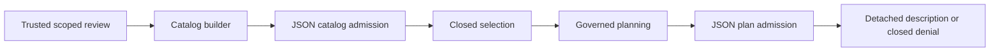

# Governed planning exchange — v1

## Scope

This pure exchange contract validates serialized discovery and selected-plan
descriptions. It builds on the completed [planning workflow](data-hub-profile-planning-contract.md).
No endpoint, UI, authentication adapter, database/query/count execution, AI,
raw-cell access, migration or Production change is added. The decoder imports
only pure metadata contracts. Existing count-response behavior is unchanged.



## Contracts

| Function | Input | Correlation expectations |
| --- | --- | --- |
| `parsePlanningCatalogResponse` | Unknown decoded value | Closed dataset context and exact review revision |
| `parsePlanningCatalogJson` | Unknown value that must be a JSON string | Same catalog expectations |
| `parsePlanningSelectionResponse` | Unknown decoded value | Closed context, ready state and admitted selection |
| `parsePlanningSelectionJson` | Unknown value that must be a JSON string | Same selection expectations |

The expected context has all eight own data identity properties. Wire envelopes,
nested contexts, request templates and plans are closed own enumerable data
records. Accessors, inherited required properties, hidden/symbol extras and
unexpected diagnostics are rejected. Dense list copying uses own index data
descriptors; custom iterators are not invoked. Accepted nested records and
lists are detached copies containing validated scalar metadata.

The JSON helpers convert malformed text, non-object envelopes and format errors
to `PLANNING_RESPONSE_INVALID`. They return no source snippets, exception message,
HTML or other diagnostic content. HTTP status, authentication, request cancellation,
body limits and transport failures belong to the separately scoped
[authenticated integration](data-hub-planning-integration.md). This is not a
general JavaScript sandbox or transport implementation.

## Catalog success

The root is exactly `{ ok: true, catalog }`. The catalog contains only
`catalogVersion`, `context`, `reviewRevision`, `readinessState` and `requests`.
Version must be v1, revision a positive safe integer, and state READY or
READY_WITH_ACKNOWLEDGED_NOTICES. The first template is ROW_COUNT; remaining
templates are distinct v1 AGGREGATE/COUNT_PRESENT measure references. Grouping,
generic aggregates, duplicate IDs, reordered row templates, labels, statistics
and count values are invalid. The complete discovery inventory may exceed 20
templates; submission limits belong to the selection/bundle contract.

All eight context identities and the supplied review revision must match the
expectation. A structurally valid different revision/context yields
`PLANNING_RESPONSE_MISMATCH`; it is not relabeled or automatically adopted.

## Selected-plan success

The root is exactly `{ ok: true, bundleVersion, reviewRevision, plans }`.
Bundle version is v1 and there are 1–20 plans. Each entry contains exactly
`context` and `snapshot`. Plans use the supported plan/readiness/schema/profiler/
quality-resolution versions and one ready state. ROW_COUNT has only its closed
lineage and operation fields. COUNT_PRESENT additionally requires a nonblank
field identity and EXCLUDE_MISSING. Count values, evidence/statistics, grouped
operations, unexpected policy and unknown plan metadata are invalid.

The decoder re-admits the expected selection, then matches the returned revision,
number of plans, full lineage, ready state, selected operation, measure identity
and order. With row count selected, it is first. Measure identities retain exact
spelling and caller order. Missing, extra or reordered valid plans yield
`PLANNING_RESPONSE_MISMATCH`. A single invalid or mismatched plan rejects the
whole response, with no partial decoded plans.

Planning correlations deliberately pin the selected review exactly. The existing
count-response parser can preserve legitimate newer execution lineage; that
separate result behavior is unchanged. A planning mismatch must not silently
substitute choices or make a stale plan appear current.

## Denials and the decoder result

Closed wire denials contain only `{ ok: false, code }`, with an optional
`requestIndex` for selected-plan failures. The fixed allowlist covers current
pure-planner denials and named authorization/profile/review-loading denials.
Unknown/future codes, messages, traces, result fields and partial plans are
invalid envelopes. Loading and initial admission codes cannot carry indices.
An indexed planning failure requires a safe integer within the selected request
list. Catalog denials never carry a request index.

Decoder admission and wire outcome are distinct:

```ts
const decoded = parsePlanningSelectionJson(body, expectation);
if (!decoded.ok) return decoded.code;            // malformed or mismatched
if (!decoded.response.ok) return decoded.response.code; // valid closed denial
const plans = decoded.response.plans;            // descriptions only
```

Both decoder mismatch/invalid references are retained by the existing safe
display mapper. No decoded outcome authenticates a caller, proves database
freshness or grants execution authority. Even a correctly shaped authorization
denial is only decoded data, not independently verified server provenance.

## Acceptance and integration handover

Tests round-trip actual synthetic profile-derived review through discovery,
selection and planning, then JSON admission. They cover independent copied
records, inventories beyond 20, all eight identities, older/newer revisions,
every algorithm version, invalid/mixed ready states, request order and field
mismatch, no partial output, malformed JSON, unexpected statistics/diagnostics,
accessors, sparse lists and indexed denials. A real derived hold remains a denial
through the same exchange. No count evaluator is used in the new round-trip path.

The separate [authenticated integration package](data-hub-planning-integration.md)
implements these duties; they are not established by pure exchange tests:

1. An authenticated manager/tenant boundary with identities derived server-side.
2. Authoritative current profile and saved review loading in one consistent
   snapshot; project only closed allowed responses/denials from internal services.
3. No client-supplied review/schema/readiness/statistics/catalog as authority.
4. Matching request expectations, late-response cancellation/discard, and clearing
   prior plans on invalid/mismatched/denied responses; no automatic execution.
5. Explicit refresh after review/profile changes, accessible selection controls,
   and isolated browser → API → database → response acceptance.
6. Separate release authority and owner verification of the existing D4D5Q
   prerequisite before any Production release. Main auto-deploys and PR #419
   remains under its release hold.

Production and hosted authenticated transport remain untouched. Integration
acceptance and its proof limits are recorded separately from pure exchange proof.
