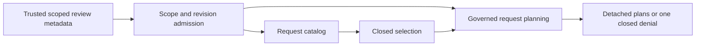

# Governed profile planning workflow — v1

## Phase boundary

This contract completes pure discovery, selection and planning for ROW_COUNT
and COUNT_PRESENT. It adds no query/count execution, API, UI, AI, raw-cell access,
migration, persisted prepared state or Production changes. Existing authenticated
review/count services remain separate. Plans and catalogs are descriptions,
never execution grants or proof of saved reviews, fresh pointers or permission.



## Entry points and responsibilities

| Contract | Responsibility | Accepted output |
| --- | --- | --- |
| `buildReviewedProfileCountRequestCatalog` | Discover target-supported templates from reviewed metadata | Context, revision, ready state, row and present-measure templates |
| `parseProfileCountSelectionInput` | Admit a closed scalar selection and copy identities | Version, expected revision, row choice, ordered distinct IDs |
| `buildReviewedProfileCountSelection` | Revalidate selected fields against the supplied review | Existing all-or-nothing plan bundle |
| `buildReviewedProfileCountPlan` | Plan one explicit intent | Scoped plan and admitted revision |
| `buildReviewedProfileCountBundle` | Plan a bounded ordered explicit request list | Scoped plans, bundle version and admitted revision |

Internal `admitReviewPlanningScope` checks all eight identities in both schema
and quality contexts against the trusted expected dataset. It copies the closed
expected context and captures a positive safe integer review revision once,
before readiness derivation. Single, bundle, catalog and selection entry points
share this admission. It reads no review snapshots and establishes no provenance.

The caller owns authorization and authoritative metadata loading. These pure
functions do not load the database, determine the latest revision, accept a
client catalog as authority, or persist review decisions. The supplied review
must come from a trusted loader; matching caller-created objects is insufficient.

## Selection format

```json
{
  "selectionVersion": "v1",
  "expectedReviewRevision": 6,
  "includeRowCount": true,
  "measureColumnIds": ["amount", "duration"]
}
```

All four fields must be own enumerable data properties, without extra string or
symbol keys. Accessors and inherited fields are rejected without invoking
property getters. The revision must be a positive safe integer, the row choice
a boolean, and measure IDs nonblank distinct strings. IDs retain exact spelling;
neither normalization nor silent deduplication occurs. Lists are copied by own
index descriptors without using custom iterators; holes, inherited IDs and
accessor entries are invalid selections.

Selections contain 1–20 total requests. Including row count leaves room for
19 measures; without row count up to 20 measures are accepted. Discovery may
list more templates because an inventory is not a submitted bundle. Selection
duplicates are invalid; the lower-level explicit bundle contract continues to
preserve deliberate duplicate intents.

## Planning and denial ordering

1. Admit scope and the supplied review revision before interpreting a selection.
2. Copy and structurally validate the selection; invalid input returns
   `PROFILE_SELECTION_INVALID`, retained by the closed display-reference mapper.
3. Compare its expected revision to the admitted revision. Mismatch returns
   `REVIEW_REVISION_MISMATCH` before semantic/quality snapshot access.
4. Derive owned readiness once for the selected bundle. Unknown quality,
   schema/quality lineage mismatch, holds, invalid catalogs and unsupported
   algorithm versions retain the existing governed denials.
5. Plan ROW_COUNT first when selected, followed by COUNT_PRESENT for IDs in
   selection order. Every ID must still be a measure in the supplied review;
   missing or changed field eligibility yields `CAPABILITY_NOT_AVAILABLE`.

The existing bundle result reports the zero-based request index for an indexed
failure. With row count selected, the first measure has index 1; otherwise it
has index 0. A later failure returns no accepted subset. Review-preparation
failures retain index 0. Quality holds take precedence over field availability
after valid input and revision admission. Malformed selection admission is not
reclassified as a quality decision.

Accepted plans copy context and scalar intent metadata. Later mutation of source
selection lists, request objects, expected context or review revision cannot
relabel those plans. Old plans remain descriptions after review changes; a later
authorized caller must replan with current scoped review metadata. No plan is
reusable authorization, and supplied revision equality proves no database freshness.

## Acceptance and next boundary

The focused suite exercises shared scope admission across all four entry points,
exact identity/revision checks, accessor rejection, input copying, maximum-size
selections, field eligibility, holds/notices, and no partial output. The pure
pipeline fixture uses actual synthetic profiler/semantic/quality derivation,
discovers requests, selects measures, plans, then rejects revision changes and
holds. It stops before count evaluation. Product statistics/raw values do not
enter catalog templates or plan results.

Pure v1 discovery/selection/planning is complete within this scope. Wiring new
catalog/selection endpoints or controls is a separate integration scope, with
authenticated loading and consistent database snapshots as acceptance duties.
Production release remains a separate held decision: `main` auto-deploys, and
the owner must verify/authorize the existing D4D5Q migration prerequisite before
release. CI success does not satisfy that prerequisite. See the existing
[release plan](data-hub-analysis-release-plan.md) for ordered rollout/rollback.
